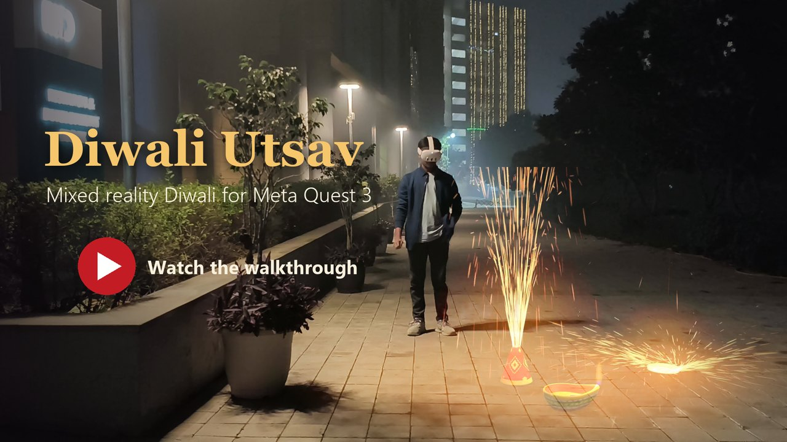
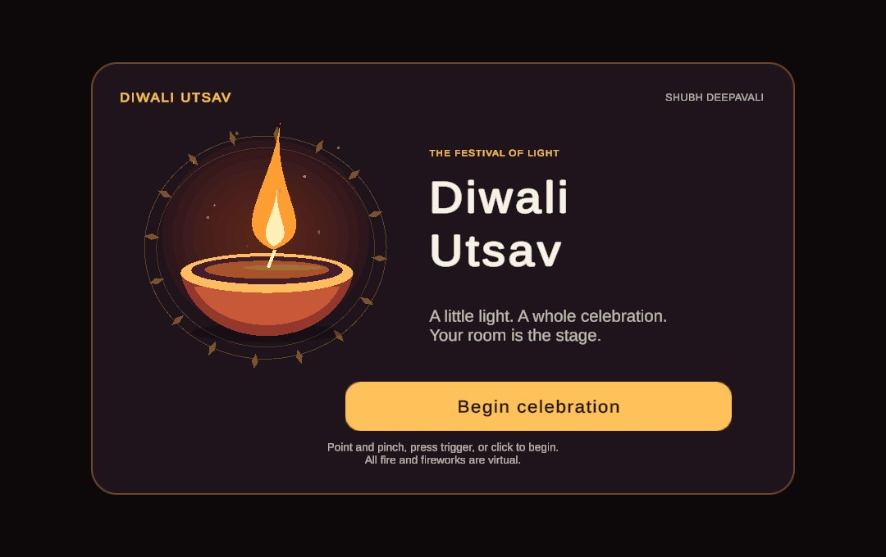
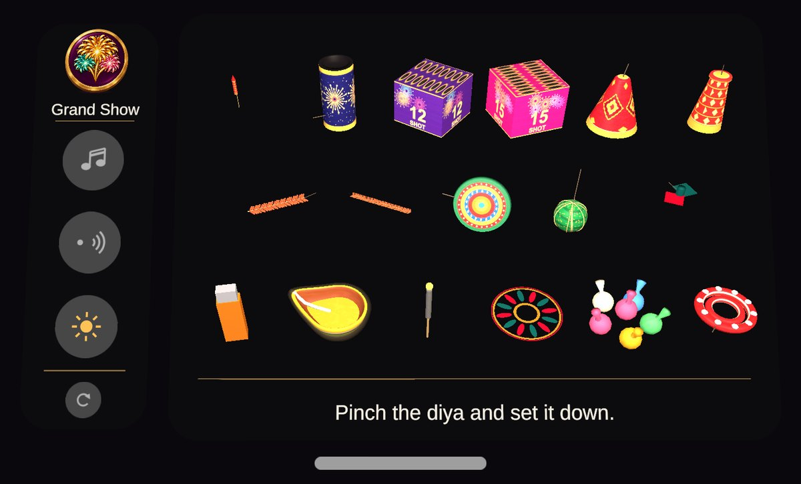
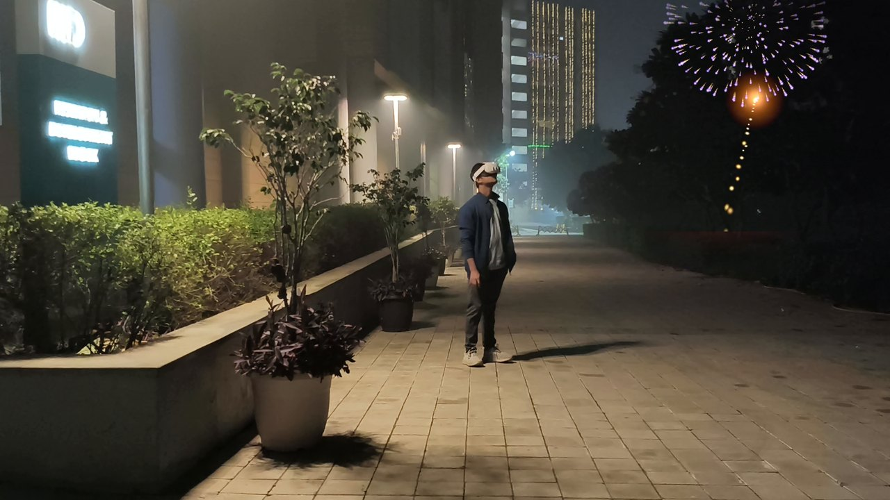
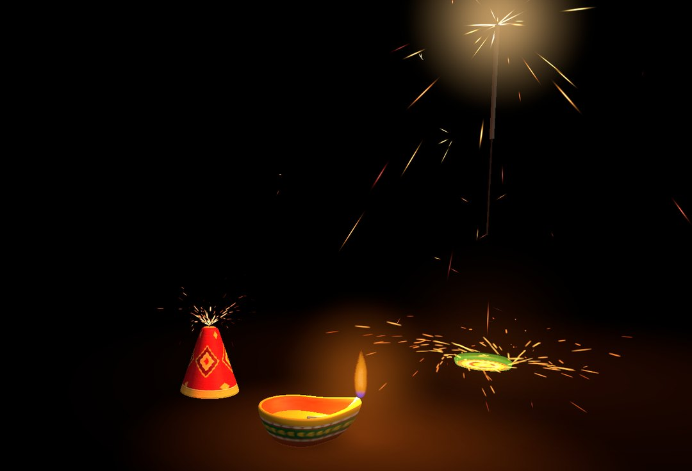
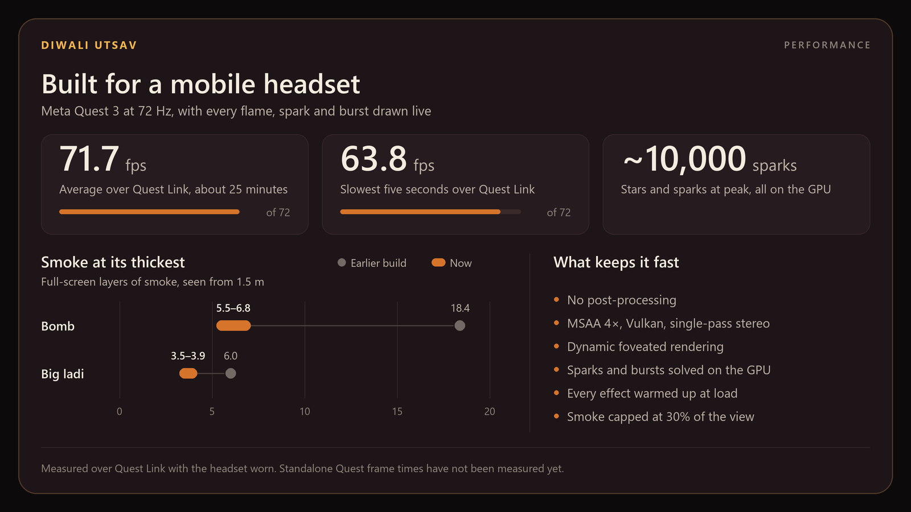

# Diwali Utsav

[](https://youtu.be/ayYrKow6v7U)

**A mixed reality Diwali for Meta Quest 3, built in Unity 6.** Diwali Utsav brings the sights and sounds of the Festival of Lights into your own room, terrace or courtyard. Your real surroundings stay in full-colour passthrough. Diyas, rangoli and eighteen Indian crackers and fireworks are virtual: they sit on your real floor, light it, and sound as if they are in the space with you. There is no smoke, no fire and nothing to clean up.

Place and light an anar, spin a chakri, draw with a phuljhadi, set off a ladi, launch a rocket and finish with a Grand Show. Everything works with your hands: pinch, grab, place, light, celebrate.

TRAILER_VIDEO_URL

*The trailer: Diwali Utsav played in a real courtyard. For the full 3-minute first-person walkthrough, [watch it on YouTube](https://youtu.be/ayYrKow6v7U).*

| | |
| --- | --- |
| **Platform** | Meta Quest 3 and 3S (also declared for Quest Pro and Quest 2) |
| **Engine** | Unity 6000.3.26f1, Universal Render Pipeline 17.3 |
| **XR** | OpenXR 1.19, Meta XR SDK 207.0.1 (passthrough, MR Utility Kit, XR Audio) |
| **Input** | Hand tracking (pinch and grab with either hand) and Touch controllers |

## Contents

- [Install the app](#install-the-app)
- [What you can do](#what-you-can-do)
- [Applications](#applications)
- [How it is built](#how-it-is-built)
- [Build and run from source](#build-and-run-from-source)
- [Testing and editor tools](#testing-and-editor-tools)
- [Project structure](#project-structure)
- [Media and the trailer](#media-and-the-trailer)
- [Status and known limitations](#status-and-known-limitations)
- [Credits and licences](#credits-and-licences)
- [Contributing](#contributing)
- [Changelog](#changelog)

## Install the app

Download **[DiwaliUtsav.apk](https://github.com/amrutmuj/DiwaliUtsav/releases/latest/download/DiwaliUtsav.apk)** from the [latest release](https://github.com/amrutmuj/DiwaliUtsav/releases/latest) – Quest build (~88 MB, Android arm64, Vulkan, API 32+).

1. Turn on **Developer Mode** for the headset in the Meta Horizon phone app.
2. Connect the headset by USB-C and allow USB debugging when the headset asks.
3. Install with Meta Quest Developer Hub (drag the APK onto the device), SideQuest, or adb:

   ```bash
   adb install -r DiwaliUtsav.apk
   ```

4. On the headset, find **DiwaliUtsav** under **Unknown Sources** in your Library. Allow the **spatial data** permission when it is requested; the app uses it only to find your floor.

Play standing in a clear space of about 2 × 2 metres. Everything virtual stays in front of you, but you will want to step around the fountains.

## What you can do

### The launch splash

The app opens on a small card in your room: rangoli petals turning slowly around a lit diya, with the original score **A Little Light** playing. Point and pinch, press the controller trigger, or click the diya or **Begin celebration**. The card fades and the celebration starts. The splash appears once per launch; **Reset** later reloads only the celebration.



### The menu

Then there is one thing to learn: **pinch or grab to take, release to place or throw.**



- **The menu** waits to your left at waist height, so the view ahead stays clear. Pinch the bar beneath it with either hand to move it anywhere. It remembers where you left it, relative to your body, and follows lazily when you turn or walk.
- **Three rows** run from what fills the sky, through what sits on the ground, down to what you hold. A soft halo around a miniature's edge marks the next suggestion, and one line of guidance suggests the next step along an eight-step journey.
- **The side panel** sits beside the fireworks so the two never mix. It holds the **Grand Show** and four quiet controls: music, gentle mode, a sun and night toggle and, set apart at the foot, reset. Reset leaves the menu where you put it.

### The eighteen items

| Row | Item | What it does |
| --- | --- | --- |
| Sky | **Rocket** | Climbs from its stand and bursts 18 m overhead |
| Sky | **Sky Shot** | One big shell, bursting 23 to 26 m up |
| Sky | **12 Shot** | Twelve golden shells, fired one at a time, bursting 20 to 22 m up |
| Sky | **15 Shot** | Fifteen shells in every colour, fired one at a time |
| Sky | **Grand Show** | A full show across your sky, ending in a finale (side panel) |
| Ground | **Anar** | A tall fountain of gold |
| Ground | **Flower Pot** | A fountain that turns from silver to green |
| Ground | **Chakri** | Spins up, skitters across the floor and coasts to a stop |
| Ground | **Small Ladi** / **Big Ladi** | A tight string that rattles, jumps, builds smoke and leaves red paper on the floor |
| Ground | **Bomb** | A 5 to 7 second fuse, then one sharp report, a flash and a rising plume |
| Ground | **Ring Caps** | A ring of tiny snaps |
| Ground | **Butterfly** | Spins, flutters and lifts with coloured sparks |
| In hand | **Lighter** | Lights fuses and diyas; lit only while held |
| In hand | **Diya** | A clay lamp to light and leave burning |
| In hand | **Phuljhadi** | A sparkler to hold and draw with; burns for 26 seconds |
| In hand | **Rangoli** | Colour for your floor; once placed it stays put |
| In hand | **Hand Popper** | Grab it and throw it; it snaps on impact |

### How you interact

- **Place by ray.** Select a miniature from a distance and the full-size cracker appears on the floor. Hold the pinch or grip, aim to move the cracker itself, and release to place it. A landing ring marks the spot, one to two metres ahead and never beside you; a quick pinch places it 1.5 metres ahead. Point at an unlit cracker within two metres to pick it up and move it again.
- **Grab up close.** Reach an unlit cracker, pinch or grip its body, carry it, and open your hand to let it go. Either hand can take it from the other. A burning or spent cracker cannot be moved. Each cracker type has its own bounce, rocking, friction and landing sound.
- **Both hands work the same.** Each hand can carry or place its own item, and a soft edge halo marks the region you can grab.
- **Hold to carry, open to release.** The lighter and phuljhadi stay in your hand while you pinch or grip. Opening the hand drops them under gravity. The lighter goes out the moment you let go and vanishes when it reaches the floor; its menu tile gives it back. A dropped phuljhadi keeps burning where it falls and can be picked up again.
- **Lighting is physical.** Touch a flame to a fuse, or the phuljhadi to a burning diya. Pinching a fuse from where you stand does the same, for anyone who prefers not to reach. A pinch on a fuse always lights it and never picks the cracker up.
- **Throw a Hand Popper.** It is the only item that is thrown rather than placed. It flies with your hand's speed and spin and snaps on its first firm landing.
- **Remove one item.** Hold a pinch on a placed item for two seconds. It hides and pauses, and a **Remove** button appears for six seconds. Pressing it deletes the item at once. Tapping anywhere else, or waiting, brings it back unchanged.
- **Gentle mode** halves the music and softens flashes, and **Night** dims the passthrough a little.

Without a headset, in the Unity Editor: the mouse is your right hand. Click to pinch, hold **G** to grab, hold the right mouse button to look around, and press **Escape** to reset the view.



## Applications

- **A Diwali without the downsides.** Celebrate in a flat, on a balcony, in a hospital ward or wherever real fireworks are banned, dangerous or unwelcome, with no smoke, burns, noise complaints, pets in distress or litter.
- **Families and children.** Supervised children can light a virtual anar or rocket safely, with gentle mode for younger or sensitive players.
- **Cultural sharing.** Introduce diyas, rangoli and the Indian cracker line-up (anar, chakri, phuljhadi, ladi, sutli bomb) to people far from home or new to the festival.
- **Events and demos.** A short, self-explanatory showcase for exhibitions, school festivals, office celebrations and Quest demo stations.
- **A reference for mixed reality developers.** A complete, small Unity 6 project that shows passthrough-first design, floor-only MRUK use, hand interaction without menus in the play space, effects that fit a mobile headset, and spatial audio. See [How it is built](#how-it-is-built).

## How it is built

### Design principles

- **The real room is the stage.** Passthrough never goes away. There are no virtual rooms, sky domes or automatic dimming.
- **Objects and gestures over menus.** One line of guidance at a time, no button panels in the play space.
- **Realistic fire.** Flames, sparks and smoke are judged from rendered images, not from tests alone.
- **Honest status.** The app says on the menu if passthrough fails, rather than showing black.

### Scenes and flow

| Scene | Purpose |
| --- | --- |
| `Assets/Scenes/SplashScreen.unity` | Launch-only entrance with its own rig, input targets, music and lit diya. No celebration objects. |
| `Assets/Scenes/DiwaliExperience.unity` | The celebration. Starts immediately with the menu ready. **Reset** reloads only this scene. |

Build Settings list them in that order. The score and transition cue live on one persistent audio owner, so they survive the scene change without restarting.

### Runtime architecture

All runtime code is in `Assets/Diwali/Runtime` (C#, no third-party gameplay frameworks):

| Area | Scripts |
| --- | --- |
| Session and rig | `DiwaliSession` (journey, reset), `FestivalRig` (hands, controllers, desktop preview, Quest tuning), `FestivalPerf` (`[Perf]` logging), `FestivalWarmup` |
| Floor and placement | `FloorLayer`, `FestivalPlacement`, `FestivalToss`, `BallisticFlight`, `CrackerPhysics`, `GrabZone`, `FestivalHeld`, `FestivalToolDrop`, `FestivalRemoval`, `FestivalRemoveButton` |
| Items | `FestivalItem` base with `DiyaItem`, `DecorItem`, `FountainItem`, `SpinnerItem`, `ChainItem` (ladi), `BlastItem` (bomb), `ButterflyItem`, `PopperItem`, `RocketItem`, `MortarItem` (shot boxes), `LighterItem`, `SparklerItem`, `FestivalFuseTarget` |
| Sky | `SkyShow` (shell styles, Grand Show and finale) |
| Effects | `FlameDriver`, `SparkField`, `EdgeHalo`, `FestivalAmbience` (sun and night) |
| Audio | `FestivalAudio` (voice pool, spatialisation, ducking, speed-of-sound delay), `FestivalSoundBank`, `FestivalMusic`, `FestivalMusicPlayback` |
| Menu and interface | `ThaliMenu`, `ThaliTile`, `ThaliHandle`, `ThaliSetting` (the menu), `FestivalHint`, `FestivalSplash`, `FestivalSplashArt`, `FestivalSplashButton`, `WelcomeCard`, `FestivalCatalog` |

Cracker prefabs, the catalog (`FestivalCatalog.asset`) and the sound bank (`FestivalSoundBank.asset`) are generated by the editor scene builder from code in `Assets/Diwali/Editor`, then tuned by hand.

### Mixed reality

- **One floor layer.** The only part of the room the app uses is the floor, out to 10 metres from you. Placement works from the first frame using the floor height from headset tracking. MRUK is asked once to refine that height and is then released, so it builds no room meshes or colliders. A soft ring sweeps across the floor to show it has been found.
- **No occlusion.** Nothing is depth-tested against your room, so there are no silhouettes or edge artefacts around hands and furniture. Virtual objects always draw over the room, which also means they can appear in front of real furniture.
- **Light on your floor.** Every flame drives a matching pool of light on the floor below it, and contact shadows darken the passthrough under each object. That is what stops things looking pasted on.
- **Sun and night.** The room starts on Sun, exactly as it is. Night dims the passthrough a little. A blast briefly lifts the room's brightness as one soft pulse.
- **Stable decorations.** Diyas and rangoli are saved with spatial anchors and restored once on launch, but stay in world space during the session, so anchor corrections never make them drift.

### Effects

Every effect is drawn live, with no post-processing, so the passthrough stays clear.

| Effect | What you see |
| --- | --- |
| Flame | A soft, see-through flame: white core, orange edge, a blue skirt and a clear gap at the wick. It leans when carried, and its glow and the light on the floor flicker with it. |
| Sparks | Fountains, the chakri and burning fuses throw dense showers of sparks that skip off your real floor. |
| Phuljhadi | Forking, crackling sparks from a burning point that creeps down the wire. |
| Sky bursts | Peony, chrysanthemum, willow, ring, palm, spider, arc and bead shells with curved trails, in colours taken from photographs of real fireworks. Each burst is sized for its height. |
| Smoke | Soft puffs that thin and drift as they age. Smoke is capped at 30% of the view, so walking into it never fills your sight. |
| Embers | Hot flecks that arc, skip across the floor and cool after every ground report and the bomb. |



### Sound

- **Spatial audio.** Meta XR Audio, with one position per sound. Rocket audio separates the motor burn from the coast whistle and follows the moving body. Sky bursts arrive after their flash, delayed by distance at the speed of sound. Large sources such as bursts and finale thunder are given a size, so they read as less of a point.
- **28 loop voices** with priorities, so a long ladi cannot cut off a fountain.
- **Recorded fireworks.** Laddi, rockets, mortar thumps, whistles, sky bursts, crackle, fuses, butterfly, ring caps and the distant celebration use CC0, CC BY 3.0 and public-domain recordings (see [Credits](#credits-and-licences)). The bomb is a single CC0 firecracker report, timed to its flash.
- **Original sounds.** Anar, chakri, phuljhadi, lighter, ignition, flame and interface sounds are original to the project.
- **Music.** **A Little Light** is an original two-minute stereo score: flute-like phrases, plucked strings, a drone and quiet percussion. It plays on the splash and fades out on **Begin**, with one soft confirmation sound. Gentle mode halves it.

### Performance



To watch it yourself, `[Perf]` lines report frame rate and hitches every five seconds, in the Console over Link or with `adb logcat -s Unity` on the headset.

## Build and run from source

### Requirements

- **Unity 6000.3.26f1** from Unity Hub, with **Android Build Support** (including OpenJDK and Android SDK & NDK Tools).
- **Windows** with the **Meta Quest Link** app, to play in the Editor over Link.
- A **Meta Quest 3 or 3S** with Developer Mode on.
- About 6 GB of free disk space for the Library cache and the build.

All packages, including the Meta XR SDK, come from the Unity registry and are restored automatically on first open.

### Open the project

The source is at **[github.com/amrutmuj/DiwaliUtsav](https://github.com/amrutmuj/DiwaliUtsav)**. Clone it, or use **Code → Download ZIP** there:

```bash
git clone https://github.com/amrutmuj/DiwaliUtsav.git
```

1. In Unity Hub, choose **Add → Add project from disk** and select the cloned folder. Open it with 6000.3.26f1.
2. The first import takes several minutes.
3. Open `Assets/Scenes/SplashScreen.unity`. **File → Build Profiles** should list the splash first and the experience second, with **Android** active.

### Play over Quest Link

1. In the Meta Quest Link app, turn on **Developer Runtime Features**, **Passthrough over Meta Quest Link** and **Spatial Data over Meta Quest Link**.
2. Connect the headset with Link and put it on.
3. Press **Play** in Unity.

No APK is needed to see a change. `DiwaliLinkSetup` keeps the Standalone XR profile ready for Link on every script reload and before Play; leave **Initialize XR on Startup** on in the Standalone XR settings.

With no headset connected, Play opens the desktop preview, a stand-in room with mouse controls (see [How you interact](#how-you-interact)).

### Build the APK

Choose **Diwali → Build Quest APK**. It writes `Builds/DiwaliUtsav.apk` and a summary to `Verification/android-build.txt`, and applies the Quest player settings and the passthrough, anchor, scene and hand-tracking features.

From the command line, with the Editor closed:

```bash
Unity.exe -batchmode -quit -projectPath . -buildTarget Android -executeMethod Diwali.Editor.DiwaliWorkbench.BuildAndroid -logFile build.log
```

Then install it as described in [Install the app](#install-the-app).

## Testing and editor tools

Everything under the **Diwali** menu runs in the Editor without a headset. Results are written to `Verification/`.

| Menu item | What it does |
| --- | --- |
| **Validate Guided Experience** | Walks the whole experience with simulated hands and records evidence in `Verification/playmode-validation.txt`: passthrough in the saved scene and at run time, placement, throwing and catching, either-hand grabbing, ignition, every cracker, the rocket's flight, the sky, Grand Show and reset. |
| **Validate Splash Scene Flow** | Splash isolation, pointer routing, entry, repeated resets, remembered music mute, Remove, plus screenshots. |
| **Validate Floor Placement** | Ray placement, near carrying, hand transfer, release and settlement, tracking loss, decoration anchor stability. |
| **Validate Curved Ray**, **Validate Pinch Response** | Aim filtering, tracking recovery and curve end points; pinch timing. |
| **Validate Firework Audio** | Real playback, moving sources, burnout timing, the bomb's single recording, gentle mode and silent completion. |
| **Refresh Recorded Audio** | Re-imports the recorded clips listed in `ThirdPartySources/Audio/edits.json` and updates the shared sound bank in place. |
| **Capture Mixed Reality Preview** | Renders review images of the scene. |
| **Cinematics → Record …** | Unity Recorder captures of the splash, menu, anar, chakri, bomb, rocket, sky shot and a complete showcase, to `Recordings/`. |
| **Apply Tray Layout**, **Update Splash Presentation**, **Apply Diwali Utsav Identity** | Targeted updates to the saved scenes. |
| **Build Mixed Reality Scene** | Regenerates both scenes, every prefab and the catalog from code. See the warning below. |
| **Build Quest APK** | See [Build the APK](#build-the-apk). |

> **Warning:** **Build Mixed Reality Scene** (the `generate` bridge command) no longer matches the release. It rewrites both scenes and every prefab, including hand-tuned effects such as the anar flame. Use it only on a branch you can throw away. For effect tuning, edit `ApplyEffectTuning` in `DiwaliEffectTuning.cs` and send `fx`, which touches only the named prefabs.

### The command bridge

While the Editor is open, `DiwaliWorkbench` polls `Tools/diwali-command.txt` about once a second. Write one command into it and the running Editor picks it up and deletes the file. Console and compiler output is mirrored to `Logs/diwali-console.log`. This lets scripts and assistants drive the Editor without touching its window.

| Command | Action |
| --- | --- |
| `refresh`, `play`, `stop` | Refresh assets, enter or leave Play |
| `smoke` | Run the guided validation |
| `verify-splash`, `verify-placement`, `verify-ray`, `verify-pinch` | Run the focused reviews |
| `audio`, `review-audio`, `bench`, `bench-sky`, `bench-tools`, `bench-fuse` | Refresh audio, review it, and benchmark levels, smoke fill and sky bursts |
| `profile`, `profile-link` | Unity Profiler over the walk-through, or over XR start-up |
| `preview-bomb`, `review-rocket` | Bomb plume renders and rocket flight review |
| `fx`, `tray`, `splash`, `identity` | Targeted, release-safe updates |
| `record-complete`, `record-splash`, `capture-menu`, `retake-anar`, `record-bomb`, `record-rocket`, `record-chakri`, `record-skyshot` | Cinematic captures |
| `build` | Build the APK |
| `generate` | Full regeneration (see the warning above) |

## Project structure

```
Assets/
  Diwali/
    Runtime/        Session, rig, placement, menu, audio, ambience, sky show, one script per cracker type
    Shaders/        Flame, spark field, star burst, smoke, glow, floor light, edge halo, splash UI
    Editor/         Scene builder, mesh and VFX kits, Link setup, validation, cinematic capture, command bridge
    Prefabs/        One prefab per cracker, plus embers
    Audio/          Recorded and original sounds, and the score
    Textures/       Wrappers, UI sprites, the Grand Show button
    Art/Diya/       The clay diya model (CC0)
    Identity/       App icon sources and adaptive icon layers
    GeneratedMR/    Generated meshes and materials
    FestivalCatalog.asset, FestivalSoundBank.asset
  Scenes/           SplashScreen.unity, DiwaliExperience.unity
  StreamingAssets/  ThirdPartyAudio.txt (audio credits shipped in the build)
  Settings/, XR/, Oculus/, Resources/   Render pipeline, OpenXR and Meta XR configuration
Packages/           Package manifest and lock file
ProjectSettings/    Player, quality and build settings
ThirdPartySources/Audio/edits.json      How each recorded clip was cut from its source
Media/              Images used in this README
```

## Media and the trailer

The trailer at the top of this page and the images in `Media/` combine two sources:

- **Real footage.** A locked-off phone camera filmed the app being played in a courtyard at night.
- **In-engine captures.** **Diwali → Cinematics** uses Unity Recorder to capture the effects at 1920 × 1080 and 60 fps on a clear black background, with the desktop room and the menu hidden.

The effects were screen-blended onto the real footage and placed where they would appear in the headset: fountains on the pavement in front of the player, bursts over the trees. Captions and cards were added, and the soundtrack was mixed from the effects' own sounds, the CC0 bomb report and an original instrumental, *Diya Afterglow*. In the trailer, the menu and splash card face the camera so they can be read, whereas in the headset they face the player. For exactly what the player sees, watch the [first-person walkthrough](https://youtu.be/ayYrKow6v7U).

To make new captures, choose **Diwali → Cinematics → Record Complete Crackers Video & Images**, or send `record-complete` through the bridge. Output goes to `Recordings/Videos` and `Recordings/Images`. To lay a capture over real footage in an editor such as DaVinci Resolve or Premiere Pro, put it on the track above the footage and set the blend mode to **Screen** (or **Add**). The black background drops out.

## Status and known limitations

**Verified:**

- The automated walk-through passes with no runtime errors, and so do the splash, placement, audio and menu reviews.
- Played in a worn Quest 3 over Link: passthrough runs and the frame rate holds near 72 fps (see [Performance](#performance)).
- The release APK builds with no errors.
- Spatial audio, measured from the mixer output: a source on your left is about 11.5 dB louder in your left ear.

**Not yet verified, or not working yet:**

- **Standalone Quest performance.** The targets are a sustained 72 Hz through the Grand Show, no thermal throttling after 20 minutes, and stable memory across repeated resets. None of these has been measured on the headset itself yet.
- **Feel in the hand.** Hand input is simulated in the Editor checks. Catching thrown items, release timing and grab region sizes are calculated, not felt, and need a pass with real hands.
- **Room acoustics are not audible.** The Meta XR Audio room model is configured, but the project has no "Meta XR Audio Reflection" mixer effect, so no reflections or reverb reach the mix. Sounds were balanced dry. Turning the room on would change every sound, so it is a deliberate open decision.
- **The Music control** has no audible effect after Begin, because the score already stops then. The setting is remembered for the splash.

**Safety.** Flashes are single soft pulses, never strobes, and gentle mode softens them further. Please still review the bomb and the Grand Show with anyone sensitive to flashing light before wider use. Supervise children. Keep your play space clear, because the experience invites you to step and crouch.

## Credits and licences

**Original to this project:** all code and shaders, the app icon and splash artwork, the cracker models and wrappers, the Grand Show button sprite, the music **A Little Light** and launch jingle, the trailer music **Diya Afterglow**, and the anar, chakri, phuljhadi, lighter, flame and interface sounds.

**Third-party assets in the build:**

| Asset | Creator and source | Licence | Used for |
| --- | --- | --- | --- |
| Diwali diya (clay oil lamp) | [Innerscene](https://www.innerscene.com/tools/library/3d-parts/diwali-diya-clay-oil-lamp-with-flame-c7590741) | CC0 | The diya model (flame replaced by the project's own) |
| Firecracker with wick #2, #3, #4 | Joseph SARDIN, [LaSonotheque](https://lasonotheque.org/petard-a-meche-4-s1140.html) | CC0 1.0 | Bomb report (#4), ring caps (#2, #3) |
| Fireworks #1, Slow wick 1, Firecracker gun #1 | Joseph SARDIN, [BigSoundBank](https://bigsoundbank.com/fireworks-s0831.html) | CC0 1.0 | Launch thumps, whistles, sky bursts, fuse, distant celebration |
| Bottle Rocket | Mike Koenig, [SoundBible](https://soundbible.com/709-Bottle-Rocket.html) | [CC BY 3.0](https://creativecommons.org/licenses/by/3.0/) | Rocket motor |
| Fire Crackers | Mike Koenig, [SoundBible](https://soundbible.com/711-Fire-Crackers.html) | [CC BY 3.0](https://creativecommons.org/licenses/by/3.0/) | Ladi reports, Hand Popper snap |
| Firecrackers Going Off, Fireworks Finale | Stephan, [SoundBible](https://soundbible.com/691-Firecrackers-Going-Off.html) | Public domain (as designated by the publisher) | Sky burst, crackle, finale |
| Ground Bloom Spinner 1 and 2 | iliyabylich04, [Freesound](https://freesound.org/people/iliyabylich04/sounds/651334/) | CC0 1.0 | Butterfly |
| Interface Sounds, click_001 | [Kenney](https://kenney.nl/assets/interface-sounds) | CC0 1.0 | Selection click |
| Liberation Sans SDF | Bundled with TextMesh Pro | SIL Open Font License 1.1 | Interface text |

The recordings were trimmed, converted to mono 48 kHz, filtered, faded and level-matched. `ThirdPartySources/Audio/edits.json` records each cut, and the same credits ship inside the app as `Assets/StreamingAssets/ThirdPartyAudio.txt`. No endorsement by any creator is implied.

**Frameworks:** Unity 6 and its packages, under the Unity Companion License and Unity terms. Meta XR SDK, under the Meta Platform Technologies SDK licence. Both are restored from the Unity registry rather than redistributed here.

**This project's licence:** no licence file has been added yet. Until one is, the repository can be viewed, cloned and built for personal testing under GitHub's terms, but no further reuse rights are granted.

## Contributing

- Use **Unity 6000.3.26f1** exactly; other versions will upgrade the project.
- Text assets are stored with LF line endings (see `.gitattributes`). To merge scenes and prefabs well, enable Unity Smart Merge:

  ```bash
  git config merge.unityyamlmerge.driver "'<Unity install>/Editor/Data/Tools/UnityYAMLMerge.exe' merge -p %O %B %A %A"
  ```

- Don't run **Build Mixed Reality Scene** on work you want to keep (see [Testing and editor tools](#testing-and-editor-tools)).
- Judge visual changes from rendered images or a headset, not only from passing checks, and say plainly what has not been tried in a headset.

## Changelog

**1.0.1**: cleaner audio and lighter smoke.
- Sounds no longer leak from hidden or removed items, and fuses pause while the Remove button shows.
- The bomb uses a CC0 recorded firecracker report.
- Smoke is built from many small puffs, with a size cap: the bomb peaks at a third of its earlier fill.
- One shared embers system serves every ground report.
- Sky bursts were rebuilt from reference photographs and sized to their height.
- A sun and night toggle replaces the night sky dome.
- Remove deletes an item at once, with no undo.
- Dynamic foveation and effect warm-up were added.

**1.0.0**: first release.
- Separate launch splash and celebration scenes.
- Brand identity, app icon and the stereo score *A Little Light*.
- Eighteen items on a two-panel menu.
- Recorded firework audio, ballistic flight per cracker, and either-hand grab regions.

---

Wishing everyone a very Happy Diwali. 🪔
